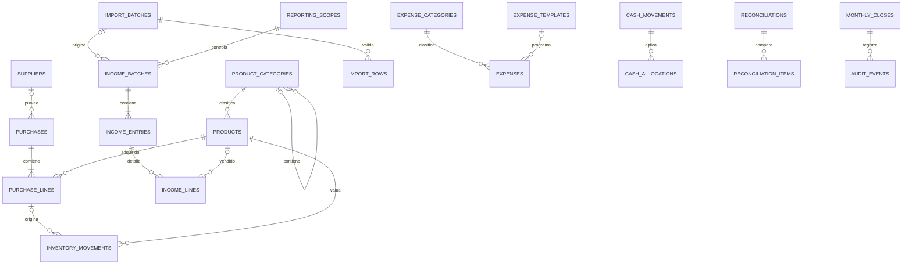

> Actualización vigente: el propietario retiró los módulos de productos e inventario. La aplicación opera con compras por importe, saldos monetarios y costos documentados externamente. Las propuestas de inventario que siguen corresponden al diseño inicial.

> Actualización de alcance: por decisión del propietario se retiró la API de Clip y el módulo Dev. La integración vigente usa exclusivamente reportes CSV/XLSX con efectivo y tarjeta; no requiere credenciales de Clip. Las referencias a API en este diseño inicial describen una propuesta anterior.

# 3dprintmty Tienda — Diseño inicial para aprobación

Fecha: 10 de noviembre de 2026. Estado: diseño aprobado por el usuario; implementación local inicial disponible. Consulta `../README.md` para el arranque y las dependencias pendientes de conexión real.

Base funcional: `context.md`. Referencia técnica inspeccionada: `../3dprintmty-erp`.
Decisiones confirmadas: un solo usuario; inicio con saldos e inventario de apertura y movimientos nuevos; preferencia por obtener los datos disponibles mediante la API de Clip.

## 1. Diagnóstico técnico

La carpeta de Tienda contiene únicamente `context.md`: no existe aplicación ni configuración de dependencias que conservar.

El ERP es un monorepo npm workspaces con Node >=22 y TypeScript estricto. Se verificaron sus manifiestos y código, no solo su README:

- `apps/web`: React 19, Vite 6, Tailwind CSS 4, React Router 6, TanStack Query 5, i18next y Supabase JS.
- `apps/api`: NestJS 11 sobre Express, ejecución TypeScript con tsx, validación Zod 3 y verificación JWT con jose.
- Persistencia: PostgreSQL mediante pg y Drizzle ORM; PGlite para desarrollo/pruebas; migraciones SQL versionadas con checksums y bloqueo.
- Paquetes compartidos y dominio: contratos, errores y cálculos puros; decimal.js para cálculos precisos.
- Verificación: Vitest, Supertest, typecheck por workspace y comprobación del empaquetado de despliegue.
- Despliegue documentado: frontend en Vercel, API Docker en Render y PostgreSQL/Auth en Supabase. Son destinos propuestos, todavía no aprovisionados para Tienda.

La interfaz actual usa Montserrat, fondo gris claro, paneles blancos, texto slate, azul primario, naranja secundario, navegación lateral de 240 px, formularios y tablas con filtros, paginación, avisos y estados de carga.

Hay documentación histórica desactualizada: la migración `20261101053558_remove_activity_audit.sql` elimina la auditoría de actividad aunque documentos anteriores todavía la describen. Tienda necesita su propio historial de ajustes por el requisito de cierre mensual. No se copiarán las migraciones del ERP.

## 2. Arquitectura propuesta

Se conservarán las herramientas y patrones técnicos; las entidades, reglas, migraciones y pantallas serán nuevas para la tienda.

```text
apps/
  web/src/
    app/                 rutas, proveedores y shell
    components/          formularios, tablas, avisos y navegación
    features/            dashboard, compras, gastos, ingresos, inventario…
    lib/                 cliente HTTP, sesión, formato e i18n
  api/src/
    db/                  conexión, esquema y migrador
    http/                guard, errores y contexto de usuario
    modules/             módulos financieros independientes
packages/
  domain/src/            dinero, valuación y fórmulas de Tienda
  shared/src/            contratos y errores compartidos
supabase/migrations/     esquema SQL nuevo
scripts/                 build y comprobaciones de despliegue
docs/                    decisiones y guía de operación
```

Flujo: navegador → Supabase Auth para identidad; navegador → API `/api/v1` con JWT → PostgreSQL para todos los datos de negocio. React Query administra consultas y actualizaciones.

Autenticación privada por correo y contraseña para el único propietario. Sin registro público ni regla de «el primero que se registre es dueño». Usuario autorizado aprovisionado explícitamente; el guard valida JWT y autorización en cada solicitud. Sin tenants, talleres, suscripciones, consola de plataforma ni selección de negocio.

Base con tablas de negocio inaccesibles para `anon` y `authenticated` por la Data API. Rol de ejecución de la API sin DDL y sin BYPASSRLS; políticas vinculadas al único usuario autorizado mediante contexto validado de la API. Credencial de migración separada. PGlite solo para desarrollo/pruebas; nunca fallback silencioso en producción.

Supabase previsto: `https://bokjsjmwvyoxbduxyoth.supabase.co`. Frontend con URL y publishable key; secret key exclusivamente en servidor si una operación administrativa de Auth la necesita. Sin secretos en documentación, código, URLs o logs. Variables locales excluidas de Git. No se ha contactado ni modificado la base.

`DATABASE_URL` y la conexión de migración deben obtenerse del proyecto: la secret key HTTP no es una contraseña PostgreSQL. También falta el correo del propietario para habilitar el acceso privado.

## 3. Modelo entidad-relación



Las relaciones por origen de movimientos se implementan con FK concretas y restricciones, no solo referencias de texto sin integridad.

## 4. Definición de tablas

Convenciones: UUID, fechas de negocio tipo `date`, eventos `timestamptz`, zona `America/Monterrey`, autor y timestamps. Estados `text` con `check`. Documentos confirmados se corrigen mediante reversas o versiones, no borrando historial.

### Configuración y catálogos

- `app_settings`: registro único; nombre, moneda MXN, zona horaria, fecha de apertura y propietario Auth autorizado. No contiene claves de Clip.
- `product_categories`: nombre, padre opcional, activo. Sin ciclos. Categorías iniciales de `context.md`.
- `products`: SKU único normalizado, identificador Clip opcional único, nombre, marca, categoría, modelo/variante, precio de referencia y activo. Costo promedio derivado de movimientos, no editable como saldo independiente. Subcategorías y variantes flexibles.
- `suppliers`: nombre, referencia fiscal opcional, contacto, notas y activo.
- `expense_categories`: nombre y activo; semillas según `context.md`.
- `payment_methods` y `payment_fee_rules`: nombre, tasa, fijo, IVA de comisión, recargo MSI y vigencia. Reglas sin solapamientos por método/plan; una comisión real prevalece sobre la estimada, que permanece identificada.

### Compras y gastos

- `purchases`: fecha, proveedor, referencia, estado, descuentos, IVA acreditable/no acreditable, flete, otros costos y observaciones. Duplicados por proveedor/referencia se revisan; el folio interno siempre es único.
- `purchase_lines`: compra, producto, cantidad, costo unitario, descuento, impuestos y costos adicionales asignados. Conserva el costo final histórico de la recepción.
- `expenses`: fecha, categoría, concepto, proveedor opcional, importe base, IVA, estado, método previsto, notas y comprobante privado opcional. Tipo explícito para distinguir gasto operativo de activo; compras nunca entran aquí.
- `expense_templates`: gasto recurrente, periodicidad y siguiente vencimiento. Generación idempotente por plantilla/periodo; un vencimiento no implica pago efectivo.

### Ingresos e importaciones

- `reporting_scopes`: periodo `[inicio, fin)`, canal y tipo de fuente activa para reconocimiento de ingresos. Restricción que impide periodos activos solapados en el mismo canal. Un archivo que cruza coberturas se divide en la preparación.
- `income_batches`: alcance, origen (`clip_api`, `clip_import`, `manual_summary`), periodo, estado, versión, lote reemplazado e importación opcional. Solo una versión activa por alcance.
- `income_entries`: lote, identificador externo, fecha/periodo, canal, estado, importes antes/después de impuestos, descuento, devolución, comisión real/estimada y método. Solo registros confirmados intervienen en reportes. El impuesto desconocido es nulo, no cero.
- `income_lines`: ingreso, producto/categoría opcionales, cantidad, ventas asignadas y costo histórico conocido. Un desglose complementa al ingreso existente; nunca genera otro total de ventas. Costo desconocido nulo, nunca cero implícito.
- `import_batches`: archivo, SHA-256, origen, tipo de reporte (cobros o artículos), perfil de columnas, estado, conteos, versión del parser y autor. Conserva archivo original privado sujeto a límite de tamaño y política de retención.
- `import_rows`: lote, número de fila, datos normalizados, huella y errores. Unique por lote/fila. Referencias externas únicas por proveedor/cuenta/tipo/ID; un reembolso usa su ID y referencia al cobro original.
- `clip_sync_runs`: periodo solicitado, cursor/página de avance, estado, conteos, último éxito y errores sin credenciales. Registra el historial de sincronización y permite reintentar sin duplicar operaciones.

### Inventario, efectivo y cierre

- `inventory_movements`: producto, fecha, tipo (apertura, adquisición, venta, devolución, ajuste o reversa), cantidad firmada, valor firmado y origen mediante FK. Inmutables al confirmar; saldo agregado consistente con movimientos.
- `inventory_reconciliations` y `inventory_reconciliation_lines`: corte, cantidades Clip, saldo financiero, diferencia, motivo y ajuste vinculado. No modifican Clip.
- `cash_accounts`: efectivo, banco y saldo por liquidar de Clip, con saldos de apertura documentados.
- `cash_movements`: fecha efectiva, cuenta, dirección, importe y tipo (cobro, pago, reembolso, transferencia, aporte/retiro o apertura). FK a documento y referencia externa única cuando exista.
- `cash_allocations`: aplica movimientos a compras, gastos o ingresos mediante FK opcionales y check de exactamente un destino; soporta pagos parciales. Las aplicaciones no pueden exceder ni el movimiento ni el saldo del documento.
- `reconciliations` y `reconciliation_items`: vinculan cobros, comisiones, devoluciones y liquidaciones de Clip. Transferir de Clip al banco no crea una venta ni una segunda entrada en el flujo consolidado.
- `monthly_closes`: mes único, estado, checklist, versión de fórmulas, snapshot de resultados, advertencias y fecha de cierre/reapertura.
- `audit_events`: actor, acción, motivo, entidad y versión anterior/nueva. Historial inmutable de confirmaciones, reemplazos, ajustes y reaperturas; sin credenciales.
- `idempotency_requests`: usuario/operación/llave únicos, hash de petición y respuesta; reserva y efectos en una sola transacción.

Importes finales en centavos `bigint`, como el ERP; cantidades y costos unitarios en `numeric` con precisión suficiente (propuesta `numeric(20,6)`). Cálculo con decimal.js y serialización decimal por cadenas: nunca usar floats JavaScript para dinero. Descuentos y flete se distribuyen antes de redondear; residuo asignado de forma determinista para conservar el total. Margen no almacenado como fuente independiente.

## 5. Módulos y pantallas

- Inicio `/app`: dashboard, periodo, cobertura y pendientes.
- Ingresos `/app/ingresos`: lista por fuente, captura consolidada, detalle y complementos de costo/categoría.
- Importaciones `/app/importaciones`: carga, mapeo, validación, vista previa, confirmación e historial.
- Compras `/app/compras`: lista, captura con múltiples partidas, prorrateo y pagos parciales.
- Gastos `/app/gastos`: registro rápido, filtros, recurrencias y pagos.
- Catálogo `/app/productos` y `/app/proveedores`: búsqueda, edición y archivo lógico.
- Inventario `/app/inventario`: apertura, movimientos, valuación y conciliación contra Clip; cobertura visible.
- Efectivo `/app/efectivo`: cuentas, movimientos, pagos/cobros pendientes y conciliación de liquidaciones.
- Reportes `/app/reportes`: estado de resultados, categorías, flujo, inventario y exportaciones.
- Cierre `/app/cierres`: checklist mensual, bloqueos, snapshot y reapertura con motivo.
- Configuración `/app/configuracion`: datos de tienda, categorías, métodos/comisiones y configuración de apertura.

Se reutilizará el lenguaje visual del ERP, con navegación simplificada, botones primarios azules, naranja reservado para pendientes, tablas filtrables, formularios claros y menú adaptable a móvil. Componentes de presentación libres de reglas del ERP podrán adaptarse; no se copiará su `App.tsx` monolítico ni sus pantallas operativas.

## 6. Clip: capacidades y flujo de información

**Fuente preferente: API de Clip.** Investigar y preparar su integración desde el MVP, utilizando los datos que los endpoints y permisos reales permitan obtener. Orden de preferencia: API → importación CSV/XLSX → captura consolidada documentada para información faltante. La prioridad de la API no implica que proporcione detalle de artículos, costos o inventario operativo.

Investigación pública oficial realizada el 10 de noviembre de 2026:

- Clip documenta que la API de transacciones no almacena productos vendidos; también indica exportación de transacciones en Excel/CSV desde su panel. Fuente: https://developer.clip.mx/page/preguntas-frecuentes
- La API lista pagos por fechas con paginación, hasta 100 registros por página y un rango máximo de 720 horas por solicitud. Fuente: https://developer.clip.mx/reference/transactions

Estas capacidades públicas no confirman qué reportes, columnas o permisos están disponibles en la cuenta particular. No se ha accedido a ella. Una exportación real definirá el mapeo definitivo; no se inventará un formato «Clip» universal.

Flujo preferente: sincronizar desde la API de Clip con credenciales de servidor → normalizar y validar datos → detectar duplicados y conflictos de cobertura → persistir atómicamente → actualizar reportes y registrar el resultado de la sincronización. La primera carga debe permitir revisar el alcance y los totales antes de activar los ingresos.

Flujo de respaldo o complemento: exportar desde Clip → subir CSV/XLSX → identificar tipo de reporte → mapear columnas → validar fechas, moneda, signos, impuestos y estados → revisar filas, duplicados y cobertura → confirmar atómicamente → actualizar reportes y conservar origen. Si falta acceso API o un dato no está expuesto, este flujo mantiene operativo el sistema sin inventar información.

Los reportes de cobros y los de artículos tienen funciones distintas. Un detalle de artículos se enlaza con su ingreso o sirve como desglose de un consolidado, sin duplicar sus importes. Si no existe llave de enlace, la conciliación debe resolverse explícitamente. Con impuestos desconocidos, mostrar «importe cobrado» y bloquear la métrica «ventas sin IVA» completa hasta documentar la base.

Archivos sin ID estable: la huella ayuda a detectar candidatos pero no elimina automáticamente dos ventas legítimas iguales. Exigir resolución en vista previa y conservar decisiones al reprocesar. Un archivo idéntico puede devolver el resultado previo; un archivo corregido requiere comparación por fila y referencias.

Integración API prioritaria, sujeta a acceso autorizado: credenciales de servidor, páginas, intervalos de hasta 720 horas, cursor incremental con ventana de revisión para cambios/cancelaciones, reintentos acotados y conciliación. Mostrar última sincronización exitosa, alcance, fallos y acción para reintentar. Un fallo conserva los datos previamente confirmados y advierte su fecha de actualización. No implementar cobros ni POS.

## 7. Prevención de duplicados

1. Cada cobertura de fechas/canal tiene una fuente activa de ingresos. Importado y consolidado no se suman sobre el mismo alcance.
   La sincronización API comparte las referencias externas y reglas de deduplicación con la importación de archivos. Un cobro obtenido por ambas vías se reconoce una sola vez; discrepancias se muestran para conciliación, sin reemplazo silencioso.
2. Si existe un consolidado y llega un archivo, se muestra la diferencia y se reemplaza su versión atómicamente tras confirmación. Nunca se activa silenciosamente.
3. Costos y distribución por categoría complementan los ingresos activos; no son ingresos nuevos. El prorrateo conserva el total o muestra diferencia pendiente.
4. Compras y movimientos de inventario se confirman una vez mediante idempotencia y FK de origen única. Ingreso con detalle descuenta existencias una sola vez; un consolidado sin detalle no descuenta unidades arbitrarias.
5. Comisiones asociadas a cobros se reconocen ahí. Gastos manuales de comisión requieren verificar origen/periodo y enlazar o excluir duplicados; no se presupone detección perfecta sin referencia.
6. Liquidaciones se concilian con cobros existentes. Cancelaciones, reembolsos y devoluciones conservan vínculo al original y sus efectos financieros diferenciados.
7. Una transacción de base incluye confirmación, movimientos, referencias únicas e idempotencia. Locks por producto/cobertura, en orden estable, evitan confirmar dos veces o valuar con un saldo anterior.

## 8. Cálculos financieros y calidad de datos

Modelo de gestión, no contabilidad fiscal completa. Cada importe conserva base e impuesto conocidos; el sistema no aplica 16 % universal a datos cuyo tratamiento no esté documentado.

- Ventas netas = base de ventas confirmadas − descuentos − devoluciones de venta, todos sin IVA cuando se conoce.
- Costo de adquisición = costo neto de mercancía + flete + costos atribuibles + impuestos no recuperables. IVA acreditable se guarda separado. Prorrateo inicial por valor neto de partidas; si la base total es cero, exigir distribución explícita.
- Promedio ponderado = (valor anterior + valor recibido) / (unidades anteriores + unidades recibidas). Salidas usan el promedio vigente al movimiento; devoluciones usan costo de la salida original cuando está disponible.
- Costo vendido = suma de salidas valuadas o costo consolidado documentado; no sumar ambos para la misma cobertura.
- Utilidad bruta = ventas netas − costo vendido.
- Margen bruto = utilidad bruta / ventas netas. Con denominador cero o negativo: no disponible.
- Contribución = utilidad bruta − comisiones − otros costos variables de venta.
- Resultado operativo = contribución − gastos operativos devengados. La compra de mercancía no es gasto operativo; los activos no se descuentan como gasto al adquirirlos.
- Margen operativo = resultado operativo / ventas netas, cuando el denominador es positivo.
- Flujo de efectivo = cobros efectivamente disponibles − pagos a proveedores − gastos efectivamente pagados − otras salidas operativas. Mostrar aportes/retiros, activos y transferencias aparte; excluir transferencias internas y saldos de apertura del flujo del periodo. Cobro en Clip y liquidación bancaria mantienen cuentas separadas sin doble conteo.
- Inventario = apertura + entradas valuadas − salidas valuadas ± ajustes. Sin detalle suficiente, se identifica como parcial o pendiente de conciliación.
- Rotación = costo vendido / inventario promedio para el mismo periodo y alcance; antigüedad basada en entradas registradas, indicando que promedio ponderado no identifica físicamente qué unidad permanece.
- Retorno sobre capital: diferido hasta definir con el propietario qué capital incluir y contar con saldos confiables. No usar inventario final como sustituto silencioso del capital invertido.

Cada agregado devuelve estado `completo`, `parcial` o `no_disponible` y motivos. El dato faltante es nulo. No presentar costo omitido como costo cero ni rentabilidad de toda la tienda a partir de una fracción sin advertencia. Reportar cobertura por importe y filas; calcular SKU/categoría solo con detalle suficiente.

Movimientos retroactivos: prohibidos en meses cerrados. En meses abiertos, recalcular desde el movimiento afectado bajo bloqueo y conservar versión/ajuste auditable. No permitir existencias negativas como si fueran valuación válida; resolver apertura o ajuste antes de confirmar la salida.

## 9. Diseño del dashboard

Cabecera: «Resumen financiero», periodo y acceso a exportación. Estado de datos visible y acciones para completar costos, importar o conciliar.

Primera fila: ventas netas, utilidad bruta, contribución y resultado operativo; márgenes debajo del importe. Segunda fila: flujo disponible e inventario, con etiqueta de cobertura y fecha de última conciliación.

Área central: serie mensual de ventas/utilidad y composición de costos/gastos. Desglose por categoría solo si hay clasificación suficiente; distribución por método solo cuando se conoce. Tablas inferiores de compras, gastos, importaciones y pendientes. Productos rentables o de baja rotación aparecen cuando existen datos que los respalden.

Periodo global aplicado a indicadores y reportes; el inventario es saldo al corte, no suma de saldos del rango. Comparación con periodo anterior de duración equivalente, etiquetada; mes en curso contra tramo comparable. Diseño sin datos ficticios presentados como reales.

## 10. Apertura, cierre y exportaciones

Apertura guiada: fecha de corte, productos, unidades y costo de inventario inicial; saldos de efectivo/banco/Clip y documentos pendientes si existen. Validar duplicación entre apertura y primeras compras/importaciones. La apertura no representa ventas ni compras del periodo y no altera la utilidad.

Cierre mensual: revisar ventas, devoluciones, comisiones, costos, compras, inventario, gastos, pendientes y liquidaciones. Bloquear cierre definitivo con cobertura insuficiente o diferencias materiales sin resolver; permitir guardar borrador con advertencias. Confirmar genera snapshot versionado y bloquea modificaciones del mes. Reapertura explícita con motivo y auditoría; ajustes posteriores generan nueva versión del cierre, conservando la anterior.

Exportaciones de estado de resultados, ventas/costos por categoría, compras, gastos, flujo, inventario e indicadores. Estado mensual con columnas estables `Periodo`, `Concepto`, `Importe MXN`; faltantes en blanco, con estado/motivo en columnas adicionales o hoja de calidad. Incluir versión de cierre, fecha de corte y definición de periodo. CSV UTF-8 compatible con Excel y neutralización de fórmulas en texto externo; XLSX con celdas numéricas, no importes formateados como texto.

Importador/exportador XLSX requiere una dependencia adicional al ERP, seleccionada y verificada antes de implementarla. No se incorporará lógica de hojas de cálculo al dominio financiero.

## 11. Plan por fases y criterios de aceptación

1. **Diseño y aprobación (actual):** acordar esta propuesta. Sin cambios de código ni migraciones remotas.
2. **MVP financiero:** monorepo, autenticación privada, apertura, catálogo, proveedores, compras multirrenglón, gastos, integración prioritaria de API Clip con sincronización manual e historial cuando exista acceso autorizado, ingresos consolidados de respaldo, movimientos de pago/cobro, dashboard y CSV mensual. Debe distinguir compras/gastos, utilidad/efectivo y faltantes/cero. Sin credenciales Clip, desarrollar y verificar el adaptador localmente y mantener visible que no existe sincronización real.
3. **Inventario y análisis:** promedio ponderado, salidas detalladas, ajustes, conciliación y cobertura; escenarios reproducibles de compra, salida, devolución y retroactivo.
4. **Importaciones:** CSV/XLSX, mapeo, vista previa, historial, deduplicación y reemplazo de cobertura. Reimportar no altera totales; conflicto de contenido se informa antes de confirmar.
5. **Cierre y reportes:** checklist, bloqueos, snapshot, reapertura auditable, XLSX y exportaciones completas para consolidación externa.
6. **Automatización opcional:** programar la sincronización API ya integrada y agregar alertas, tras verificar permisos reales. La consulta API manual tiene prioridad desde el MVP; su ejecución periódica es una mejora posterior.

Verificación: typecheck/build, pruebas unitarias de cálculos y prorrateos; integración API/DB para autorización, atomicidad, reintentos, solapamientos, inventario y cierres; revisión responsive de flujos críticos. Pruebas PostgreSQL en base local desechable, nunca contra datos productivos. No se publicará un sistema con resultados financieros ficticios.

## 12. Decisiones y dependencias pendientes

Confirmado: solo el propietario; apertura con saldos e inventario y movimientos nuevos; API de Clip como fuente preferente. Propuesto: una tienda/MXN, herramientas del ERP, acceso privado, fuentes de ingreso excluyentes por periodo/canal, promedio ponderado y costos parciales explícitos.

Requiere aprobación: este diseño antes de implementar, conforme al apartado 19 de `context.md`.

Para conectar el entorno real: conexión PostgreSQL/runtime y migración, correo del propietario, fecha/saldos de apertura y credenciales/permisos de API Clip. Una muestra real de exportación Clip permitirá preparar el respaldo y los datos complementarios. No bloquean la implementación local posterior a aprobar el diseño. Configurar infraestructura remota y publicar requiere conocer sus destinos efectivos; no se ha realizado en esta etapa.
